# Omnibattery Cards


Ten compact, display-only Home Assistant dashboard cards for [Omnibattery](https://github.com/ffunes/Omnibattery), inspired by the energy dashboards in [EMHASS HA Companion](https://github.com/smefa/emhass-ha-companion).

[](https://my.home-assistant.io/redirect/hacs_repository/?owner=thomasvt1&repository=omnibattery-cards&category=integration)

| Card | What it shows |
| --- | --- |
| **Daily operation** | Quarter-hour operations, charge level, battery energy, solar-to-battery, consumption, and optional tariffs in a scrollable table. |
| **Energy plan** | Solar, consumption, charge level, battery activity, and optional prices on a shared timeline. Measured values and forecasts remain distinct. |
| **Overview** | Live energy flow, battery charge level, operating status, and today's energy totals. |
| **Battery** | One battery's charge level, stored energy, AC and cell power, temperature, daily totals, and available health metrics. |
| **System battery** | System charge level and stored energy, with a charge bar for every discovered battery. Three layout variants are available. |
| **Energy today** | Daily energy totals and remaining forecasts as comparable horizontal bars. |
| **Solar independence** | Daily self-sufficiency, grid import/export, and solar retention with explicit attribution assumptions. |
| **Price windows** | Current import tariff and lowest/highest upcoming two-hour windows. |
| **Forecast accuracy** | Measured solar or consumption compared with an earlier saved forecast. |
| **Status** | Charging and discharging blockers, predictive charging, reserves, connectivity, alarms, protections, and timeline freshness. |

Cards follow the active Home Assistant theme. They can open entity details, but contain no battery-control buttons and make no service calls. There are no external runtime assets or dependencies on other custom cards.

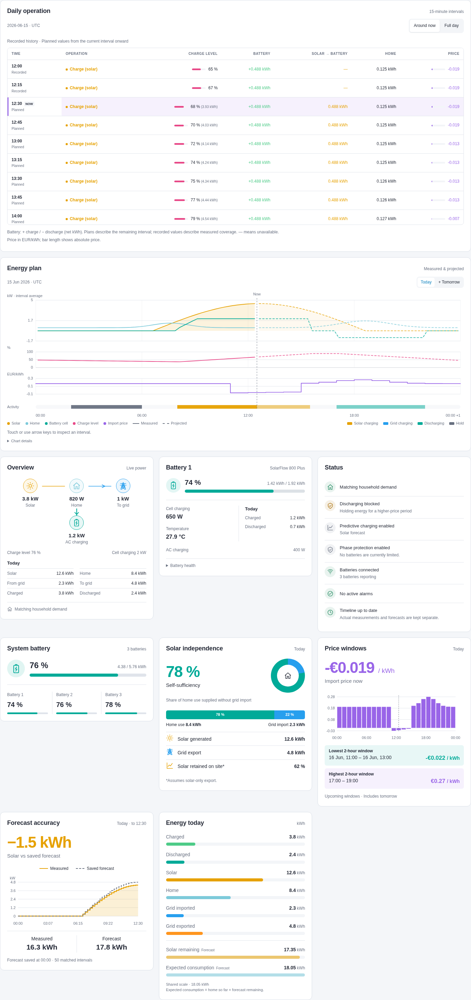

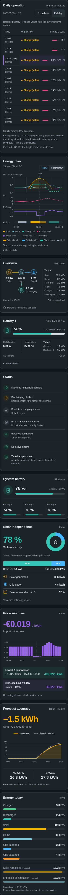

### Card previews

| Card | Light theme | Dark theme |
| --- | --- | --- |
| Energy plan | 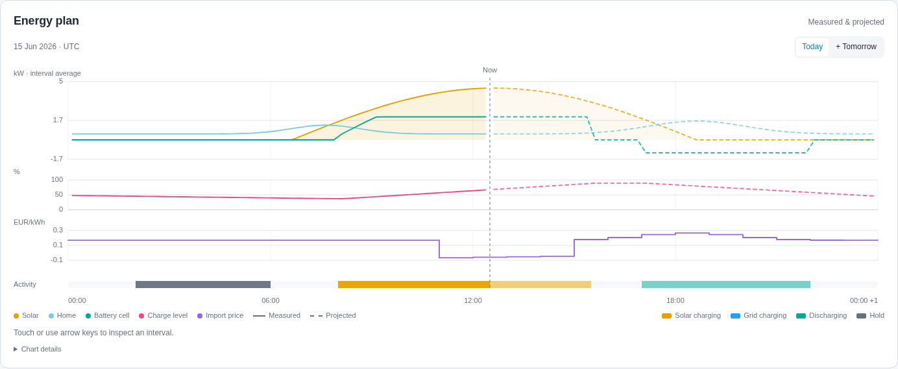 | 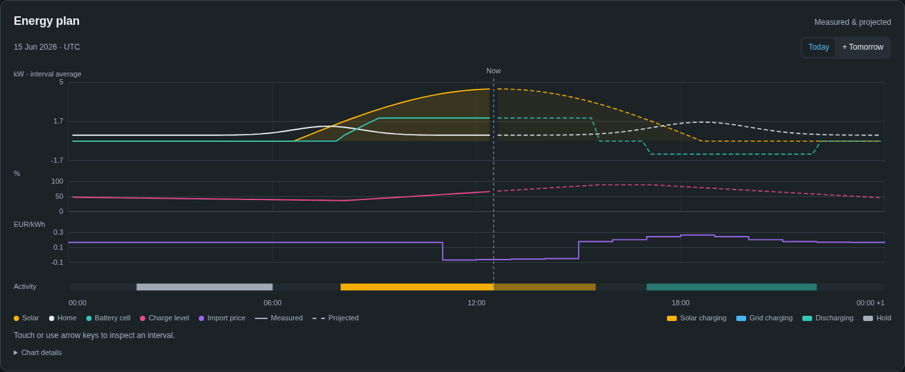 |
| Overview | 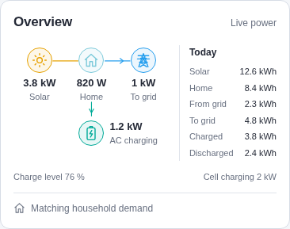 | 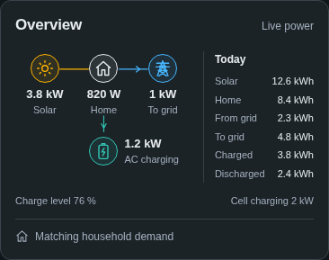 |
| Battery | 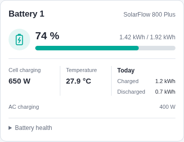 | 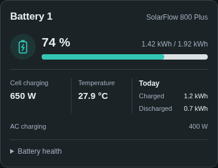 |
| System battery | 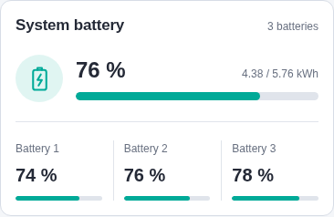 | 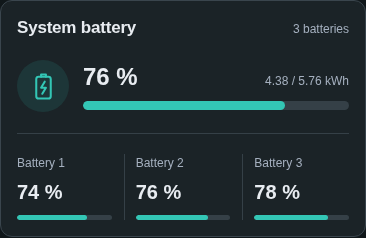 |
| Status | 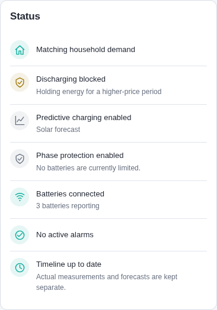 | 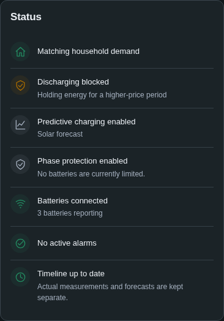 |

### Daily operation

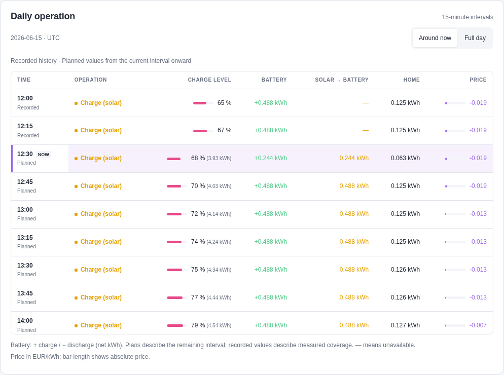

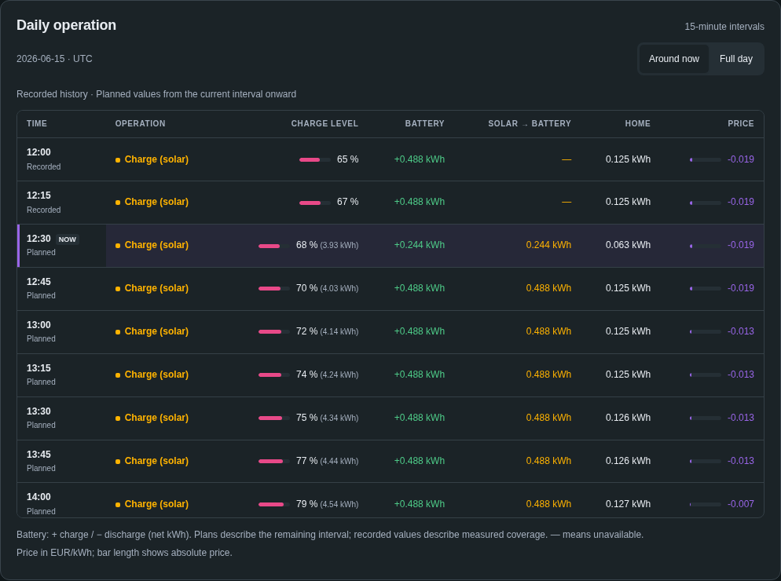

[Mobile preview](examples/daily-operation-390-dark.png) · [Mobile energy columns](examples/daily-operation-mobile-details-dark.png) · [Custom appearance](examples/daily-operation-custom-theme.png) · [Loading state](examples/daily-operation-loading.png)

### New insight cards

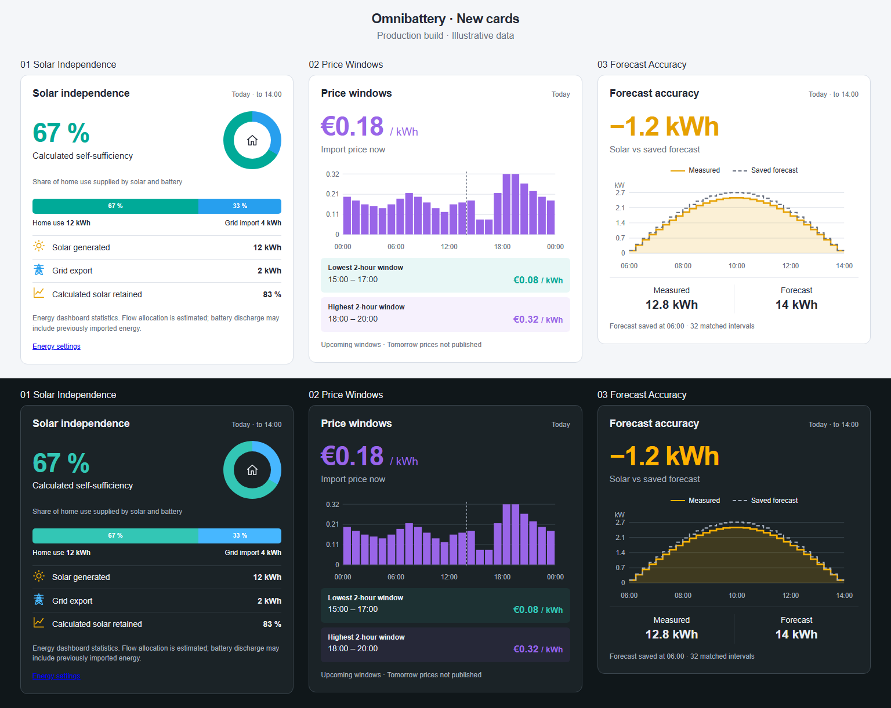

| Card | Light theme | Dark theme |
| --- | --- | --- |
| Energy today | 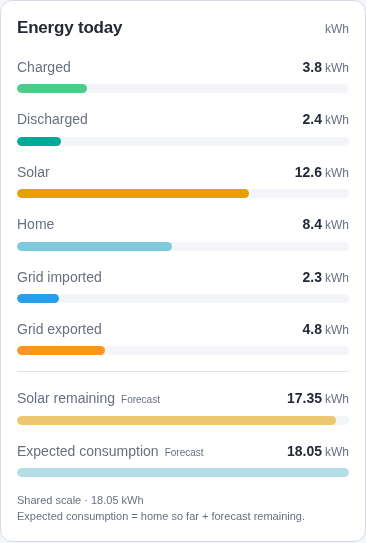 | 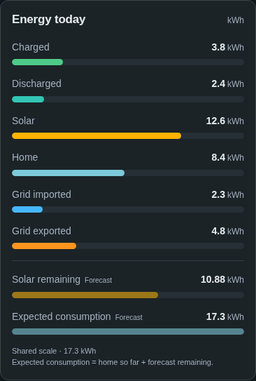 |
| Solar independence | 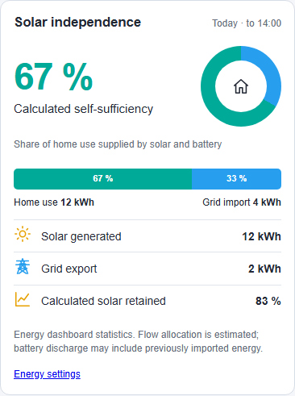 | 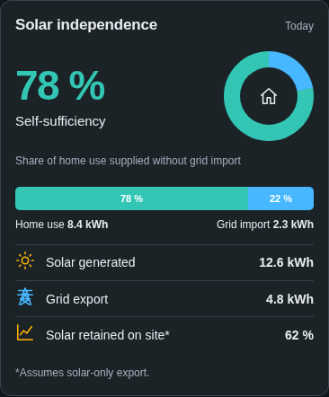 |
| Price windows | 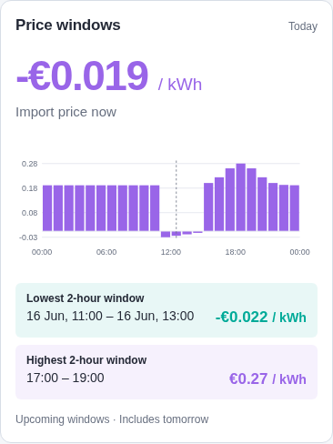 | 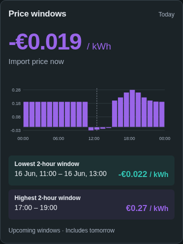 |
| Forecast accuracy | 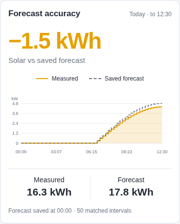 | 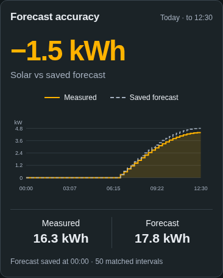 |

## Requirements

- Home Assistant **2026.10 or newer**.
- [Omnibattery](https://github.com/ffunes/Omnibattery) **1.5.0** with its entities enabled. Other versions may work if they retain the same entity and timeline interfaces.
- HACS for the recommended installation, or access to your Home Assistant `custom_components` directory for manual installation.
- Optional: a Nord Pool price sensor exposing timestamped `raw_today` and `raw_tomorrow` attributes.

## Install with HACS

Version 0.6.0 combines the cards and their recording sensors in **one HACS Integration**. It remains independent of upstream Omnibattery.

1. Open the **Add to HACS** link above, or add `https://github.com/thomasvt1/omnibattery-cards` as a custom repository with type **Integration**.
2. Download **Omnibattery Cards**, then restart Home Assistant.
3. Add **Omnibattery Cards** in **Settings → Devices & services → Add integration** ([open setup](https://my.home-assistant.io/redirect/config_flow_start/?domain=omnibattery_cards)). Confirm the timeline; calculated Solar Independence is optional.
4. Reload the browser. The integration registers the bundled cards automatically. Add them through **Edit dashboard → Add card → Omnibattery**.

This is a custom repository, not yet included in HACS's default catalogue.

**Updates:** Python integration changes require a Home Assistant restart. Frontend-only changes can be loaded with a full browser refresh after the bundle is replaced; the integration serves it without long-lived caching. HACS may still request a restart for an Integration update. Local development retains Vite hot reload through `npm run dev`.

### Migrate from the Dashboard download (0.5.x or earlier)

HACS cannot install one repository under two categories. This category change needs a one-time reinstall; a normal Dashboard update is not sufficient.

1. Keep your dashboard configurations. In HACS, remove the old **Omnibattery Cards Dashboard download**, then remove its custom-repository entry if it remains. Do not delete your dashboard cards.
2. Add the same repository as an **Integration**, download it, restart Home Assistant, and complete integration setup as above.
3. Setup replaces recognized old HACS/manual resource URLs with `/omnibattery_cards/omnibattery-cards.js?v=0.6.1`, preserving one resource ID and removing duplicate entries. Query strings such as `hacstag` are ignored when identifying old URLs. Other cards and dashboard configurations are untouched.
4. Reload every open Home Assistant browser tab. Existing `custom:omnibattery-*` card types and settings continue to work.

Recognized old paths are `/hacsfiles/omnibattery-cards/omnibattery-cards.js`, `/local/community/omnibattery-cards/omnibattery-cards.js`, `/local/omnibattery-cards/omnibattery-cards.js`, and `/local/omnibattery-cards.js`. If you used a renamed file, an absolute URL, or another path, remove that resource yourself before setup; it cannot safely be identified automatically. The integration saves the original recognized resource entries in its own migration backup before changing them, and uses Home Assistant's resource collection API.

For **YAML-managed resources**, Home Assistant will show a repair instruction instead of adding a duplicate. Replace the old entries with exactly one resource:

```yaml
resources:
  - url: /omnibattery_cards/omnibattery-cards.js?v=0.6.1
    type: module
```

Reload Lovelace resources and your browser; reload the integration to clear the repair. Update the version query on later releases. YAML dashboard layouts can still use automatically registered resources when resource management itself is in storage/UI mode.

### Manual installation and rollback

Extract `omnibattery_cards.zip` from the [latest release](https://github.com/thomasvt1/omnibattery-cards/releases/latest) into `config/custom_components/omnibattery_cards/`, restart, and add the integration. The archive contains the compiled cards, so no separate JavaScript download is needed.

To roll back to standalone cards, remove the unified integration through Devices & services, remove its `/omnibattery_cards/` resource in Dashboard Resources (or YAML), reinstall the **v0.5.0** Dashboard release in HACS, and refresh the browser. Removing the integration deletes recordings; keep a Home Assistant backup if those need preserving. Switching back also requires removing the Integration repository entry in HACS before re-adding it as Dashboard.

## Configure

Use the visual editor to select the installation, battery, and optional data sources. Empty entity fields enable automatic discovery. The cards use integration membership and stable registry metadata, so renaming an entity does not break discovery. Legacy `marstek_venus` identifiers are supported.

With a single Omnibattery installation, the smallest configuration is:

```yaml
type: custom:omnibattery-overview-card
```

Add each card independently, or start with the [example dashboard](examples/dashboard.yaml). The cards support both Sections and Masonry dashboards.

```yaml
type: custom:omnibattery-plan-card
title: Energy plan
show_extension: true
import_price_entity: sensor.your_import_price
```

```yaml
type: custom:omnibattery-battery-card
title: Garage battery
battery: YOUR_HOME_ASSISTANT_DEVICE_ID
```

Select a battery in the visual editor to fill its device ID. Repeat the Battery card for each device. The ID is a Home Assistant device-registry ID, not an entity ID, IP address, or battery name.

### Daily operation table

```yaml
type: custom:omnibattery-daily-operation-card
# Optional; discovered automatically for a single installation.
entities:
  timeline: sensor.omnibattery_daily_operation_timeline
# Optional separate tariff sensor; prices are not in the operation timeline.
import_price_entity: sensor.your_import_price
show_extension: true
```

The table uses the same schema 1 timeline as Energy plan. **Around now** starts two quarters before the sensor's current interval and shows up to six hours ahead. **Full day** shows all 96 wall-clock quarters, plus the optional published next-day extension. Scroll vertically for later rows and horizontally on phones; time and column headings stay visible.

Historical rows show recorded operations and covered consumption. The current and upcoming rows show the remaining plan, including projected stored energy when provided. Battery energy is net charge minus discharge; both channels must be known. Solar-to-battery and stored-energy projections are never presented as historical measurements. Missing values remain `—`; stale timelines suppress projections. Action masks can show multiple operations within one quarter and do not imply their order. A zero action mask means **Idle**; **Hold** requires explicit delay evidence.

Prices use timestamped import tariffs in the source unit, duration-weighted over each quarter. Gaps, overlapping tariffs, and ambiguous repeated DST quarters show `—`. Negative prices retain their sign; bar length represents absolute price. Skipped and repeated daylight-saving intervals remain labelled.

### Appearance and loading

All ten cards follow Home Assistant's active light/dark theme, typography, card surface, border, shadow, and energy colors. The native editor's **Appearance** section provides optional per-card overrides, following [Quatt Cards PR #16](https://github.com/thomasvt1/quatt-cards/pull/16). Empty fields inherit theme defaults; **Reset appearance to theme** removes only appearance overrides.

```yaml
type: custom:omnibattery-daily-operation-card
appearance:
  background: 'var(--card-background-color)'
  border_radius: 20
  padding: 12
  title_size: 19
  solar_color: '#d79500'
  price_color: '#9965e8'
```

| Options | Accepted values |
| --- | --- |
| `background`, `text_color`, `secondary_text_color`, `border_color` | CSS colors, including variables and `transparent` |
| `border_width` | 0–8 pixels |
| `border_radius`, `padding` | 0–48 pixels; zero is supported |
| `title_size`, `value_size` | 10–36 / 10–48 pixels; value size affects primary readings, not chart axes or labels |
| `shadow` | CSS box shadow, including `none` or a CSS variable |
| `hover_color`, `pressed_color`, `focus_color` | Optional interaction colors; defaults use the theme's primary color |
| `solar_color`, `home_color`, `grid_color`, `export_color`, `charge_color`, `battery_color`, `soc_color`, `price_color` | Optional energy colors |
| `success_color`, `warning_color`, `error_color`, `divider_color`, `subtle_color` | Optional status and supporting surface colors |

Initial discovery shows a theme-aware skeleton, following [Quatt Cards PR #18](https://github.com/thomasvt1/quatt-cards/pull/18). Reduced motion disables its animation. Loaded data stays visible during background refresh; failed discovery shows an error instead of an endless loader. Reconnecting starts a new discovery request even if the old connection never responds.

### System battery layouts

| Layout | Light theme | Dark theme |
| --- | --- | --- |
| Three columns |  |  |
| Familiar stack | 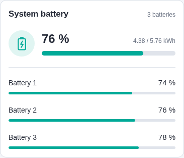 | 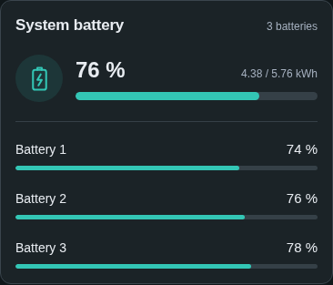 |
| Compact rows | 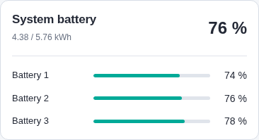 | 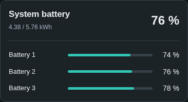 |

The System battery card shows the installation's reported charge level and stored energy, followed by all discovered battery charge bars. It uses Omnibattery's reported system charge level rather than calculating an average of the batteries. Missing or unavailable readings remain unavailable.

```yaml
type: custom:omnibattery-system-battery-card
title: System battery
layout: columns
```

Choose **Layout** in the visual editor, or set `layout` in YAML:

| Variant | `layout` | Arrangement |
| --- | --- | --- |
| **C — Three columns** | `columns` | Default. Shows up to three battery columns per row; additional batteries wrap onto the next row. |
| **A — Familiar stack** | `stacked` | Places battery charge bars in a vertical stack below the system summary. |
| **B — Compact rows** | `compact` | Uses compact battery rows below the system summary. |

No single battery selection is needed: the card discovers every battery in the selected installation. Optional entity overrides are limited to `soc`, `stored`, and `capacity` for the system summary. See [all three layout examples](examples/system-battery.yaml).

### Energy today

```yaml
type: custom:omnibattery-energy-today-card
show_forecasts: true # default; false hides the two forecast rows
```

Horizontal bars show Charged, Discharged, Solar, Home, Grid imported, and Grid exported. Every row uses the same kWh scale, set by the largest visible value. These are comparisons, not percentages of a shared total. Tap a measured value to open its sensor details.

The optional forecast rows show **Solar remaining** and **Expected consumption** (home energy so far plus remaining consumption forecast). They use today's schema 1 timeline only, including the remaining portion of the current interval and excluding tomorrow. Forecast energy is taken directly from the integration's interval energy, so partial and DST intervals are not counted twice. Forecast rows use lighter fills and explicit labels.

Missing, stale, previous-day, or incomplete forecast data stays unavailable. A known zero remains an empty bar labeled zero; unavailable data uses an em dash and dashed track. Forecasts can be hidden in the editor. Entity overrides include `dailyCharge`, `dailyDischarge`, `dailySolar`, `dailyHome`, `dailyGridImport`, `dailyGridExport`, and `timeline`.

### Solar independence

For automatic recording, [set up the bundled recording integration](https://my.home-assistant.io/redirect/config_flow_start/?domain=omnibattery_cards) under Settings → Devices & services. It suggests the Energy dashboard's grid, solar, and battery power meters. Explicitly enable calculated Solar Independence during setup. The card discovers its sensors, labels the percentages as calculated, and uses counters from the same observed period. Solar-first attribution is an estimate, not measured energy provenance. Missing readings and restart gaps are excluded and disclosed; recording starts after setup. Manual measured counters remain supported below.

```yaml
type: custom:omnibattery-solar-independence-card
entities:
  dailyGridToHome: sensor.grid_to_home_energy_today
assume_solar_only_export: true
```

Self-sufficiency is `(home energy − grid-to-home energy) / home energy`. Supply a daily `dailyGridToHome` counter in Wh/kWh that excludes battery charging. If the installation never charges batteries from the grid, `assume_no_grid_charging: true` explicitly permits using daily grid import instead. Both assumptions default to false; unavailable or inconsistent counters show an em dash. All daily counters must cover the same period and reset together. This metric describes direct grid reliance today, not the historical origin of stored battery energy.

The card automatically discovers an Omnibattery counter with the registry key `daily_grid_to_home_energy` or `system_daily_grid_to_home_energy`, including renamed entities. If the integration does not supply this counter, select an external counter explicitly. Neither a currently disabled grid-charging switch nor total daily battery charging proves how much grid energy went to the home today.

Solar retention is `(solar generation − grid export) / solar generation` and requires `assume_solar_only_export: true`. Leave it disabled when exported energy can come from grid-charged batteries. Retained energy includes battery storage and losses, not just household consumption.

### Price windows

```yaml
type: custom:omnibattery-price-windows-card
import_price_entity: sensor.your_import_price
```

Shows today's tariff chart and the cheapest/most expensive complete upcoming two-hour windows in published today/tomorrow data. Window averages are duration-weighted; windows may start now or at a tariff boundary (including two hours before an ending boundary). Gaps and overlaps disqualify a window. Negative prices, source units, and timezone-aware physical durations are preserved. Windows are information only, not battery schedules. The current price is taken from the timestamped interval, not an unrelated sensor state.

Without an override, price sources are discovered from `raw_today` / `raw_tomorrow` attributes. A unique source is selected automatically; multiple sources require a choice in the editor because their taxes, export rates, or other costs can differ. An explicitly configured export source is excluded from automatic import selection. An unavailable source is never silently replaced by a different tariff.

### Forecast accuracy

The [bundled recording integration](docs/recordings.md) saves future quarter-hour forecasts before measurement and retains them across restarts. The card discovers the matching snapshot automatically. After installation and setup, allow a complete saved interval to finish (up to 30 minutes); past forecasts cannot be reconstructed. Both this card and its editor offer install/setup links when support is missing.

```yaml
type: custom:omnibattery-forecast-accuracy-card
saved_forecast_entity: sensor.saved_energy_forecast
forecast_metric: solar # solar (default) or home
```

Omnibattery's current timeline does not retain the earlier forecast needed for this comparison. Provide a separately persisted sensor with a frozen snapshot; the card does not create helpers, capture snapshots, or make service calls. The visual editor exposes this input. Without it, the card explains what is missing.

A unique compatible saved snapshot is discovered automatically from its schema, `saved_at`, and interval attributes for the selected metric. Multiple matching snapshots require an explicit selection. Live forecasts and consumption profiles are not substituted for saved snapshots. Explicit source selections always take precedence, including when the selected entity is missing or unavailable.

The sensor must have an available state and these attributes (example timestamps must be replaced with the actual forecast day):

```yaml
schema_version: 1
saved_at: '2026-06-15T06:00:00+00:00'
intervals:
  - start: '2026-06-15T06:00:00+00:00'
    end: '2026-06-15T06:15:00+00:00'
    solar_kwh: 0.12
    consumption_kwh: 0.18
  # Continue with timestamped quarter-hour intervals for the forecast horizon.
```

The timeline must belong to today in its reported timezone; prior-day data is withheld after local midnight. Each interval must match an actual timeline interval exactly, and the snapshot must have been saved at or before that interval began. Only complete per-source measurement coverage is compared. Missing, duplicated, partial, future, and repeated DST wall-clock intervals are excluded; chart gaps remain visible. Totals cover the matched intervals only, with the count shown below the chart. The signed difference is measured minus forecast, not a percentage accuracy score.

### Common options

| Option | Type | Default | Description |
| --- | --- | --- | --- |
| `type` | string | Required | One of the nine card types listed below. |
| `title` | string | Card title | An optional custom heading. |
| `integration_id` | string | Automatic | Omnibattery config-entry ID. Select it in the editor if you have multiple installations. |
| `entities` | mapping | Automatic | Override individual sources using the role names below. |
| `grid_inverted` | boolean | Integration setting | Set `true` when your selected grid sensor is positive for export. |
| `battery` | string | Automatic | Battery device ID for the Battery card. |
| `layout` | string | `columns` | System battery layout: `columns` (C), `stacked` (A), or `compact` (B). |
| `import_price_entity` | string | None | Optional timestamped import-price source for the Energy plan. |
| `export_price_entity` | string | None | Optional explicit export-price source for the Energy plan. |
| `show_extension` | boolean | `false` | Initially show available next-day timeline data on the Energy plan. The card also has a range selector. |

Card types:

- `custom:omnibattery-plan-card`
- `custom:omnibattery-overview-card`
- `custom:omnibattery-battery-card`
- `custom:omnibattery-system-battery-card`
- `custom:omnibattery-status-card`
- `custom:omnibattery-energy-today-card`
- `custom:omnibattery-solar-independence-card`
- `custom:omnibattery-price-windows-card`
- `custom:omnibattery-forecast-accuracy-card`

### Entity overrides

Overrides take precedence over discovery. Use entity IDs exactly as they appear in Home Assistant.

```yaml
type: custom:omnibattery-overview-card
entities:
  grid: sensor.your_grid_power
  solar: sensor.your_total_solar_power
  home: sensor.your_home_consumption
grid_inverted: false
```

Supported roles:

| Group | Role names |
| --- | --- |
| Sources | `grid`, `solar`, `home`, `timeline` |
| System battery | `soc`, `stored`, `capacity`, `cellPower`, `acPower`, `chargePower`, `dischargePower` |
| System status | `status` |
| Daily energy | `dailySolar`, `dailyHome`, `dailyGridImport`, `dailyGridExport`, `dailyCharge`, `dailyDischarge` |
| Selected battery | `batterySoc`, `batteryStored`, `batteryCapacity`, `batteryCellPower`, `batteryAcPower`, `batteryTemperature`, `batteryDailyCharge`, `batteryDailyDischarge` |

Power sources support W and kW; energy sources support Wh and kWh. Explicit `cellPower`, `acPower`, `batteryCellPower`, and `batteryAcPower` overrides must be positive when charging and negative when discharging. Automatically discovered entities have their driver-specific signs normalized. `chargePower` and `dischargePower` are separate, positive AC magnitudes.

AC exchange and battery-cell power are different measurements. Solar charging can increase cell power without importing power from the grid. Select the complete solar source: the cards do not add individual MPPT values to it.

### Prices and timeline

Price sensors must supply arrays of `{start, end, value}` objects in `raw_today` and, when available, `raw_tomorrow`. Start and end values are timestamps with timezone information. Negative prices are preserved. Unavailable or unknown price entities are ignored even if they retain tariff attributes. Missing tomorrow prices stay missing; export prices are displayed only when explicitly configured.

The timeline reads Omnibattery's schema 1 data, including its next-day extension. Its power values are interval averages derived from energy and measured coverage, rather than instantaneous readings. Measured history remains separate from projections; gaps, partial intervals, and daylight-saving changes are preserved. Turning predictive charging off does not remove available profile forecasts.

The single Activity strip uses amber for solar charging, blue for grid charging, teal for discharging, and gray for supported Hold periods. Lighter blocks are projected. Split colors mean multiple activities were reported within a quarter, without implying their order or duration. Unfilled intervals do not imply Hold; that state requires explicit observation or delay evidence.

Use a pointer or touch to inspect the chart. Keyboard users can focus the chart and move through intervals with the arrow keys. Labels use Home Assistant's locale and timezone.

## Missing or unexpected data

- **No installation found:** verify Omnibattery is loaded, select an installation, or enter source overrides.
- **An optional metric is missing:** the device may not support it, its entity may be disabled, or its state may be unavailable. Unsupported values are omitted rather than filled with zeros.
- **Timeline unavailable:** enable Omnibattery's daily operation timeline sensor and check its state and attributes. Unsupported schemas are reported instead of guessed.
- **Stale forecast:** inspect the timeline's generation time and Omnibattery status. Historical measurements remain visible.
- **Wrong grid direction:** check the integration's grid direction or set `grid_inverted` for the selected source.
- **Cards unavailable after an upgrade:** verify the module resource and reload the browser cache. Remove any duplicate resource entries.

## Development

Use Node.js 24 and npm:

```sh
npm ci
npm run dev
npm run check
npm test
npm run build
npx playwright install chromium
npm run test:browser
npm run update:examples
npm run validate:previews
```

The build produces one self-contained `dist/omnibattery-cards.js` and copies it into the integration's `frontend` folder for packaging. HACS offers release archives only; a source checkout needs `npm run build` before installation. Demo fixtures use synthetic names and data; do not commit household identifiers, private Home Assistant URLs, credentials, or raw diagnostics.

For integration tests, use Python 3.13: `pip install -r requirements-test.txt`, then `pytest -q` after building the cards. The tests cover real Home Assistant setup, recordings, resource migration, and HTTP bundle serving. The optional private MCP replay is skipped without an explicit fixture path.

Run `npm run update:examples` after changing a card's appearance. The script starts and stops its own local demo server and Chromium browser, then writes PNGs directly to `examples/`: every registered card in light and dark themes, all three System battery layouts, and desktop/light and mobile/dark dashboards. It uses a fixed demo time, locale, timezone, and viewport sizes for repeatable captures. Install Chromium with `npx playwright install chromium` before the first run, and commit the regenerated PNGs with the change. If a newly registered card is missing from the demo, the script fails so its fixture can be added.

CI checks types, unit tests, the production build, browser tests, and example generation. To release, update `package.json`, the lockfile, and the integration manifest version together, add a changelog entry, and push a matching `vX.Y.Z` tag. The release workflow verifies the version, runs checks, builds, and packages the built cards inside `omnibattery_cards.zip` for HACS Integration installation; the JavaScript asset is also retained for explicit legacy/manual use.

## Credits and license

Omnibattery Cards is an independent cards and recording integration project. [Omnibattery](https://github.com/ffunes/Omnibattery) supplies the battery integration and telemetry. [EMHASS HA Companion](https://github.com/smefa/emhass-ha-companion) inspired the compact dashboard layout and timeline presentation. Home Assistant and HACS provide the dashboard and distribution platforms.

Licensed under [GNU AGPL version 3 or later](LICENSE). The frontend uses Lit, distributed under its BSD 3-Clause license; dependency notices are retained in the build where applicable. The cards do not implement energy optimization or hardware control.
